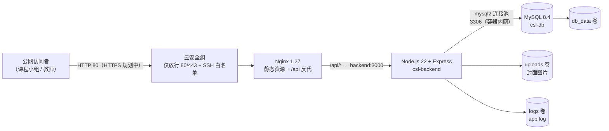
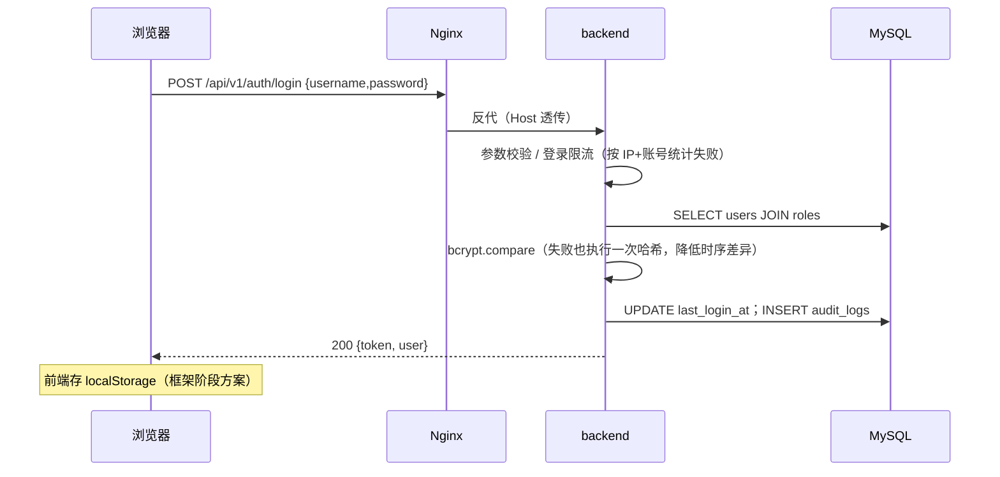
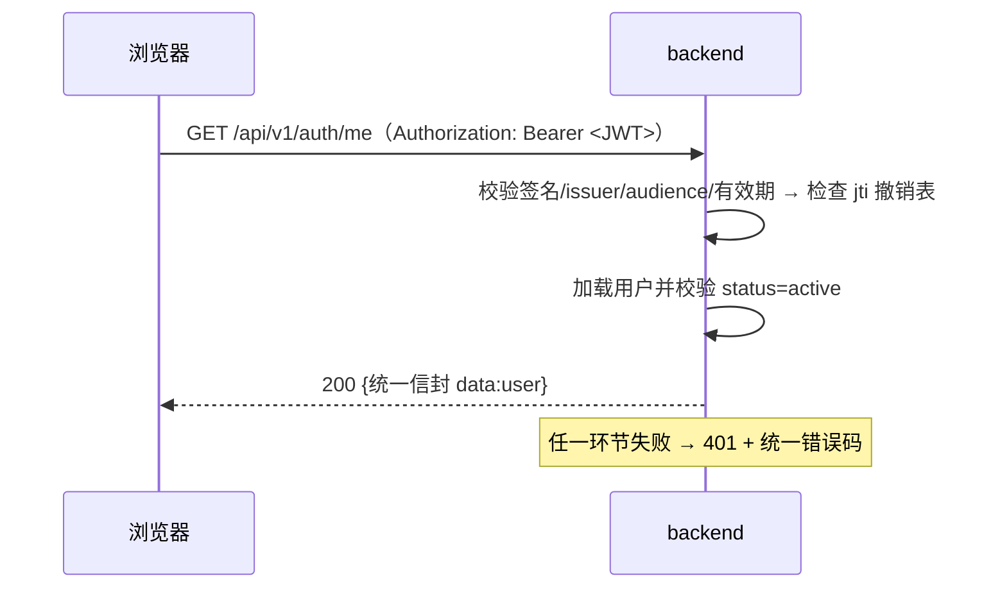

# 01 · 系统架构

> **适用对象**：后端/前端/运维同学、验收人
> **前置条件**：已阅读 [00-overview.md](./00-overview.md)；了解 HTTP 与 Docker 基本概念
> **预计耗时**：阅读 15 分钟

## 1. 总体拓扑



**三条硬约束**：

1. 只有 **Nginx** 对公网暴露端口；后端与数据库不映射宿主机端口。
2. 数据库位于 `internal: true` 的 Docker 网络，**无外网出口**，也不被公网访问。
3. 上传文件落在独立数据卷，**不在 Web 根目录**，避免被当作静态资源直接执行/读取。

## 2. 组件职责

| 组件 | 容器名 | 镜像 | 职责 | 对外端口 |
| --- | --- | --- | --- | --- |
| web | `csl-web` | `nginx:1.27.4-alpine` | 托管前端构建产物；`/api/` 反代到后端；设置安全响应头 | 宿主机 80（可配 `PUBLIC_HTTP_PORT`） |
| backend | `csl-backend` | `node:22.14.0-alpine` | REST API、认证、上传、审计 | 仅容器网络 `3000` |
| db | `csl-db` | `mysql:8.4.4` | 业务数据持久化 | 无（仅 internal 网络 `3306`） |

## 3. 后端分层

```text
HTTP 请求
  → middlewares（requestId → helmet → cors → body → 访问日志）
  → routes（注册路径，只做装配）
  → controllers（解析入参、调用 service、输出统一响应）
  → services（业务规则、认证、审计、事务边界）
  → repositories（SQL / 内存实现，按 DB_DRIVER 切换）
  → db/pool（mysql2 连接池）
```

| 层 | 目录 | 允许做的事 | 禁止做的事 |
| --- | --- | --- | --- |
| 路由 | `backend/src/routes` | 绑定中间件与控制器 | 写业务逻辑、直接执行 SQL |
| 控制器 | `backend/src/controllers` | 参数校验（走中间件）、组装响应 | 直接访问数据库、拼 SQL |
| 服务 | `backend/src/services` | 业务规则、权限判断、审计 | 处理 HTTP req/res |
| 仓储 | `backend/src/repositories` | 参数化 SQL、数据映射 | 业务判断、抛 HTTP 语义错误 |
| 模型 | `backend/src/models` | 字段常量、入参 schema、序列化 | 访问数据库 |

**为什么保留 `memory` 驱动**：让“没有 MySQL”的同学也能在 5 分钟内跑通健康检查与登录闭环（框架验收）。它只用于本地演示/自动化测试，**生产环境启动时会被配置校验拒绝**（`NODE_ENV=production` + `DB_DRIVER=memory` 直接报错）。

## 4. 关键请求时序

### 4.1 登录



### 4.2 受保护接口



### 4.3 上传

```text
POST /api/v1/uploads (multipart, 字段 file)
  → multer：扩展名/声明类型白名单、大小限制、服务端生成落盘名
  → 读取文件头 magic bytes 复核真实类型
  → 计算 sha256
  → INSERT uploaded_files
  → 写审计
  → 返回文件元数据（不返回可公开下载 URL）
```

## 5. 网络与端口矩阵

| 端口 | 位置 | 协议 | 谁可以访问 | 说明 |
| --- | --- | --- | --- | --- |
| 80 | 宿主机 → web 容器 | TCP | 公网（按安全组收敛） | 唯一公网入口；HTTPS 443 规划中 |
| 443 | 宿主机 | TCP | 公网 | **未配置证书**，预留 |
| 3000 | 容器网络（backend） | TCP | 仅 web 容器 | 后端 API |
| 3306 | 容器网络（db） | TCP | 仅 backend 容器 | 数据库 |
| 5173 | 开发机 | TCP | 本机 | Vite 开发服务器 |
| 4173 | 开发机 | TCP | 本机 | `vite preview`（构建产物预览） |
| 22 | 云主机 | TCP | **仅管理员 CIDR 白名单** | SSH 运维 |

> 生产环境**不要**给 db/backend 配置 `ports:`；安全组也**不要**放行 3000/3306。

## 6. 数据与文件

| 数据 | 位置 | 备份方式 | 备注 |
| --- | --- | --- | --- |
| 业务数据 | MySQL 命名卷 `db_data` | `mysqldump` 定时 + 部署前手动 | 卷随 `docker compose down -v` 删除，慎用 `-v` |
| 上传文件 | 命名卷 `upload_data` → 容器 `/app/uploads` | 打包该卷目录 | 元数据在 `uploaded_files`，两者需一起备份 |
| 应用日志 | 命名卷 `app_logs` → 容器 `/app/logs` | 按需归档 | 同时保留 `docker logs`（json-file 10m×3 轮转） |
| 访问日志 | Nginx stdout | `docker logs csl-web` | 不落额外文件 |

## 7. 架构决策记录（ADR 摘要）

| 编号 | 决策 | 理由 | 代价 |
| --- | --- | --- | --- |
| ADR-01 | Express 4 而非 5 | 生态稳定、中间件示例多、教学资料足 | 需手动包装 async 错误（已由 `asyncHandler` 解决） |
| ADR-02 | JWT + 进程内撤销表 | 让“退出登录立即失效”可演示，不引入 Redis | 多副本/重启后撤销状态丢失（已在 API 文档标注） |
| ADR-03 | 单角色 `users.role_id` | 课程场景足够，模型简单 | 多角色需新增 `user_roles` 表 |
| ADR-04 | 统一响应信封 | 前端错误处理统一，契约可测试 | 与第三方 SDK 风格不一致 |
| ADR-05 | 内存驱动做本地演示 | 降低“跑起来”的门槛 | 必须用配置校验防止误上线 |
| ADR-06 | 上传文件不提供公开读取 | 避免框架阶段就出现任意文件读取 | 封面展示留到 M1 用受控签名/鉴权接口实现 |

## 8. 已知限制

- 单机部署，无负载均衡与多副本；JWT 撤销表与登录限流均为**进程内**。
- 未配置 HTTPS（证书申请属于部署阶段工作，见 [04-deploy.md](./04-deploy.md)）。
- 无后台任务队列；审计写入为同步（失败只记日志，不阻断业务）。
- 前端 Token 存 `localStorage`，框架阶段方案；生产建议改 httpOnly Cookie + CSRF 防护。
