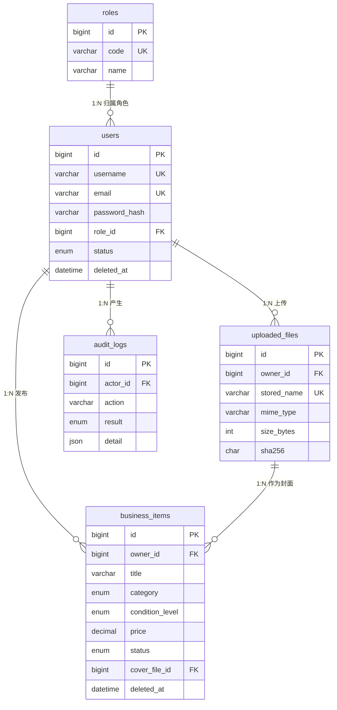

# 02 · 数据库设计

> **适用对象**：后端同学、数据库负责人、验收人
> **前置条件**：已安装 MySQL 8.4（或使用 `deploy/docker-compose.yml` 的 db 服务）；已阅读 [01-architecture.md](./01-architecture.md)
> **预计耗时**：阅读 20 分钟；从空库完成迁移 + 种子约 2 分钟

## 1. 设计原则

| 原则 | 落地方式 |
| --- | --- |
| 字符集统一 | 全部 `utf8mb4` / `utf8mb4_0900_ai_ci`，支持中文与 emoji |
| 时间统一 | 全部 `DATETIME(3)` 存 UTC；连接时区 `+00:00`，应用连接池 `timezone: 'Z'` |
| 软删除 | `users`、`business_items` 使用 `deleted_at`；查询默认过滤 `deleted_at IS NULL` |
| 外键保护 | 有从属关系的表使用 `FOREIGN KEY`，删除策略显式声明（RESTRICT / SET NULL / CASCADE） |
| 主键 | `BIGINT UNSIGNED AUTO_INCREMENT`；对外暴露 ID 在后续阶段考虑脱敏 |
| 敏感数据 | 只存 bcrypt 哈希；**不存明文密码、不存明文 token、不存证件信息** |
| 文件与元数据分离 | 文件本体在 `UPLOAD_DIR`，数据库只存元数据与哈希 |
| 迁移可重放 | 迁移文件只增不改，全部由 `backend/scripts/migrate.mjs` 按文件名顺序执行 |

## 2. ER 图



## 3. 表清单

| 表 | 用途 | 主要来源 |
| --- | --- | --- |
| `schema_migrations` | 迁移版本记录 | 迁移脚本自动维护 |
| `roles` | 角色字典 | 种子 |
| `users` | 账号 | 种子 |
| `business_items` | 业务条目（教材/笔记） | 种子（只读接口） |
| `uploaded_files` | 上传文件元数据 | 上传接口 |
| `audit_logs` | 审计日志 | 登录/退出/上传 |

## 4. 字段说明

### 4.1 `roles` 角色表

| 字段 | 类型 | 可空 | 默认 | 约束 / 说明 |
| --- | --- | :---: | --- | --- |
| `id` | BIGINT UNSIGNED | 否 | AUTO_INCREMENT | 主键 |
| `code` | VARCHAR(32) | 否 | - | 唯一，`admin` / `student` |
| `name` | VARCHAR(64) | 否 | - | 中文名称 |
| `description` | VARCHAR(255) | 是 | NULL | 角色说明 |
| `created_at` | DATETIME(3) | 否 | CURRENT_TIMESTAMP(3) | UTC |
| `updated_at` | DATETIME(3) | 否 | CURRENT_TIMESTAMP(3) ON UPDATE | UTC |

### 4.2 `users` 用户表

| 字段 | 类型 | 可空 | 默认 | 约束 / 说明 |
| --- | --- | :---: | --- | --- |
| `id` | BIGINT UNSIGNED | 否 | AUTO_INCREMENT | 主键 |
| `username` | VARCHAR(64) | 否 | - | 唯一；登录名，3～64 字符（应用层校验） |
| `email` | VARCHAR(128) | 否 | - | 唯一；可用于登录 |
| `password_hash` | VARCHAR(100) | 否 | - | bcrypt（60 字符）；禁止明文 |
| `display_name` | VARCHAR(64) | 是 | NULL | 展示名称 |
| `role_id` | BIGINT UNSIGNED | 否 | - | FK → `roles.id`，`ON DELETE RESTRICT` |
| `status` | ENUM('active','disabled') | 否 | 'active' | 非 active 不允许登录 |
| `last_login_at` | DATETIME(3) | 是 | NULL | 登录成功时更新 |
| `created_at` | DATETIME(3) | 否 | CURRENT_TIMESTAMP(3) | UTC |
| `updated_at` | DATETIME(3) | 否 | CURRENT_TIMESTAMP(3) ON UPDATE | UTC |
| `deleted_at` | DATETIME(3) | 是 | NULL | 软删除；非空即视为已删除 |

> 说明：唯一索引与软删除并存时，被软删除的用户名仍占用唯一键。课程阶段接受该限制；如需复用需改为“唯一键 + 状态”或物理归档。

### 4.3 `business_items` 业务条目表

| 字段 | 类型 | 可空 | 默认 | 约束 / 说明 |
| --- | --- | :---: | --- | --- |
| `id` | BIGINT UNSIGNED | 否 | AUTO_INCREMENT | 主键 |
| `owner_id` | BIGINT UNSIGNED | 否 | - | FK → `users.id`，`ON DELETE RESTRICT` |
| `title` | VARCHAR(120) | 否 | - | 标题 |
| `author` | VARCHAR(64) | 否 | - | 作者/整理者 |
| `category` | ENUM('textbook','notes','other') | 否 | 'textbook' | 分类 |
| `condition_level` | ENUM('new','good','fair') | 否 | 'good' | 成色 |
| `price` | DECIMAL(10,2) | 否 | 0.00 | `CHECK (price >= 0)` |
| `description` | TEXT | 是 | NULL | 描述（M1 渲染时需转义，禁止直接 innerHTML） |
| `status` | ENUM('draft','published','reserved','sold','archived') | 否 | 'draft' | 条目状态 |
| `cover_file_id` | BIGINT UNSIGNED | 是 | NULL | FK → `uploaded_files.id`，`ON DELETE SET NULL` |
| `created_at` | DATETIME(3) | 否 | CURRENT_TIMESTAMP(3) | UTC |
| `updated_at` | DATETIME(3) | 否 | CURRENT_TIMESTAMP(3) ON UPDATE | UTC |
| `deleted_at` | DATETIME(3) | 是 | NULL | 软删除 |

### 4.4 `uploaded_files` 上传文件表

| 字段 | 类型 | 可空 | 默认 | 约束 / 说明 |
| --- | --- | :---: | --- | --- |
| `id` | BIGINT UNSIGNED | 否 | AUTO_INCREMENT | 主键 |
| `owner_id` | BIGINT UNSIGNED | 否 | - | FK → `users.id`，`ON DELETE RESTRICT` |
| `original_name` | VARCHAR(255) | 否 | - | 原始文件名，仅展示；已去除路径与控制字符 |
| `stored_name` | VARCHAR(128) | 否 | - | 唯一；服务端生成（时间戳 + UUID + 扩展名） |
| `mime_type` | VARCHAR(100) | 否 | - | 由文件头检测，不信任客户端声明 |
| `size_bytes` | INT UNSIGNED | 否 | - | `CHECK (size_bytes > 0)` |
| `sha256` | CHAR(64) | 否 | - | 内容哈希，用于去重/取证 |
| `storage_path` | VARCHAR(512) | 否 | - | 相对 `UPLOAD_DIR` 的路径 |
| `status` | ENUM('active','archived') | 否 | 'active' | 归档后不可再被引用（M1 实现） |
| `created_at` | DATETIME(3) | 否 | CURRENT_TIMESTAMP(3) | UTC |
| `updated_at` | DATETIME(3) | 否 | CURRENT_TIMESTAMP(3) ON UPDATE | UTC |

### 4.5 `audit_logs` 审计日志表

| 字段 | 类型 | 可空 | 默认 | 约束 / 说明 |
| --- | --- | :---: | --- | --- |
| `id` | BIGINT UNSIGNED | 否 | AUTO_INCREMENT | 主键 |
| `actor_id` | BIGINT UNSIGNED | 是 | NULL | FK → `users.id`，`ON DELETE SET NULL` |
| `action` | VARCHAR(64) | 否 | - | 动作，如 `auth.login`、`upload.create` |
| `resource_type` | VARCHAR(32) | 是 | NULL | 资源类型，如 `uploaded_file` |
| `resource_id` | VARCHAR(64) | 是 | NULL | 资源 ID（字符串，兼容多主键类型） |
| `result` | ENUM('success','failure') | 否 | - | 结果 |
| `ip` | VARCHAR(45) | 是 | NULL | 兼容 IPv6 |
| `user_agent` | VARCHAR(255) | 是 | NULL | 截断存储 |
| `detail` | JSON | 是 | NULL | 扩展字段；**禁止写密码/token** |
| `created_at` | DATETIME(3) | 否 | CURRENT_TIMESTAMP(3) | UTC |

### 4.6 `schema_migrations` 迁移记录

| 字段 | 类型 | 可空 | 默认 | 说明 |
| --- | --- | :---: | --- | --- |
| `version` | VARCHAR(64) | 否 | - | 文件名去 `.sql`，主键 |
| `description` | VARCHAR(255) | 否 | '' | 迁移文件路径 |
| `applied_at` | DATETIME(3) | 否 | CURRENT_TIMESTAMP(3) | 应用时间 |

## 5. 索引与约束

| 表 | 索引/约束 | 类型 | 服务的查询 |
| --- | --- | --- | --- |
| `users` | `uk_users_username` | UNIQUE | 登录/查重 |
| `users` | `uk_users_email` | UNIQUE | 邮箱登录 |
| `users` | `idx_users_role_id` | INDEX | 按角色筛选（M1） |
| `users` | `idx_users_status` | INDEX | 停用账号治理（M1） |
| `business_items` | `idx_business_items_status_created` | INDEX(status, created_at) | 列表按状态 + 时间排序 |
| `business_items` | `idx_business_items_owner_created` | INDEX(owner_id, created_at) | “我的条目” |
| `business_items` | `idx_business_items_category` | INDEX | 分类筛选 |
| `business_items` | `idx_business_items_title` | INDEX(title(64)) | 标题前缀检索 |
| `uploaded_files` | `uk_uploaded_files_stored_name` | UNIQUE | 落盘名去重 |
| `uploaded_files` | `idx_uploaded_files_owner_created` | INDEX(owner_id, created_at) | 用户文件列表 |
| `audit_logs` | `idx_audit_logs_actor_created` | INDEX(actor_id, created_at) | 按人审计 |
| `audit_logs` | `idx_audit_logs_action_created` | INDEX(action, created_at) | 按动作审计 |

> 列表接口当前按 `created_at DESC, id DESC` 排序；`keyword` 使用 `LIKE '%kw%'`（参数化，不会产生 SQL 注入，但无法走前缀索引）。数据量上来后建议改为全文索引或搜索引擎。

## 6. 种子数据

文件：`db/seeds/001_seed_base.sql`（可重复执行，固定主键 + `ON DUPLICATE KEY UPDATE`）。

| 类型 | 内容 |
| --- | --- |
| 角色 | `admin`（管理员）、`student`（学生） |
| 账号 | `admin` / `student`，密码均为 `Demo@123456`（bcrypt cost=10） |
| 业务条目 | 3 条：2 条 `published`、1 条 `draft`，均属于演示学生 |
| 审计日志 | 不预置（由登录/上传产生） |

**密码哈希说明**：

- 明文 `Demo@123456` 只出现在课程文档与演示说明中，登录校验永远走 bcrypt。
- 哈希同时存在于 `db/seeds/001_seed_base.sql` 与 `backend/src/config/demo-accounts.js`，两者必须一致。
- 生成新哈希：`cd backend && node -e "console.log(require('bcryptjs').hashSync('新密码',10))"`。

**部署到公网前必须**：修改演示账号密码或停用账号，并删除种子里的演示业务数据（见 [04-deploy.md](./04-deploy.md) 上线检查清单）。

## 7. 迁移与重置

> **验证记录（2026-11-13）**：在 MySQL 8.4.4 容器中实测：迁移创建 6 张表；种子写入 `roles=2 users=2 business_items=3`；`reset → migrate → seed` 可重复执行并重新登录；宿主机开发模式（`127.0.0.1:3306`）的迁移与种子同样通过。详见 [framework-acceptance.md](./framework-acceptance.md) 附录 A。

### 7.1 首次建库（空库 → 可运行）

```bash
# 1) 配置数据库连接（.env 中 DB_DRIVER=mysql）
npm --prefix backend run db:migrate
# 2) 写入种子
npm --prefix backend run db:seed
# 3) 验证
mysql -h 127.0.0.1 -u lab_user -p course_sec_lab -e "SHOW TABLES; SELECT id, username, status FROM users;"
```

`migrate.mjs` 会：

1. 连接 MySQL 服务器并 `CREATE DATABASE IF NOT EXISTS course_sec_lab`；
2. 创建/读取 `schema_migrations`；
3. 按文件名排序执行未应用的迁移，逐个记录版本；
4. 任一迁移失败立即退出（已成功的迁移不回滚，需人工处理）。

### 7.2 重置（演示前标准动作）

```bash
# 删除全部表 + 清空上传目录
npm --prefix backend run db:reset
# 重新迁移 + 种子
npm --prefix backend run db:migrate
npm --prefix backend run db:seed
# 等价的一键脚本
bash scripts/seed.sh
```

`db/reset.sql` 关闭外键检查后按依赖顺序 `DROP TABLE`，随后删除 `schema_migrations`。**重置后必须重新迁移**。

### 7.3 迁移规范

- 文件名：`NNN_描述.sql`，三位序号递增（`001`、`002`…）。
- **已应用的迁移禁止修改**，只能新增下一个文件。
- 每个迁移必须自带注释，说明目标与回滚方式（框架阶段不做 down 脚本，回滚依赖备份）。
- 结构变更同时更新本文档与 [03-api.md](./03-api.md)（若影响接口）。

## 8. 内存驱动说明（仅本地演示）

`DB_DRIVER=memory` 时，数据位于后端进程内存（`backend/src/repositories/memory/store.js`）：

- 结构、字段名、返回形状与 MySQL 行保持一致，便于复用同一套 service/序列化/测试；
- **不持久化**：重启即恢复种子状态；
- 未实现事务、并发控制、索引；
- 生产环境启动时会被 `config` 直接拒绝。

## 9. 账号与权限（数据库层）

- 应用使用独立账号 `lab_user`，只拥有 `course_sec_lab` 库的增删改查权限；不使用 root 连接应用。
- Docker Compose 中 root 密码只用于初始化与 `mysqladmin` 健康检查。
- 禁止把数据库端口暴露到公网；连接只允许来自 backend 容器。
